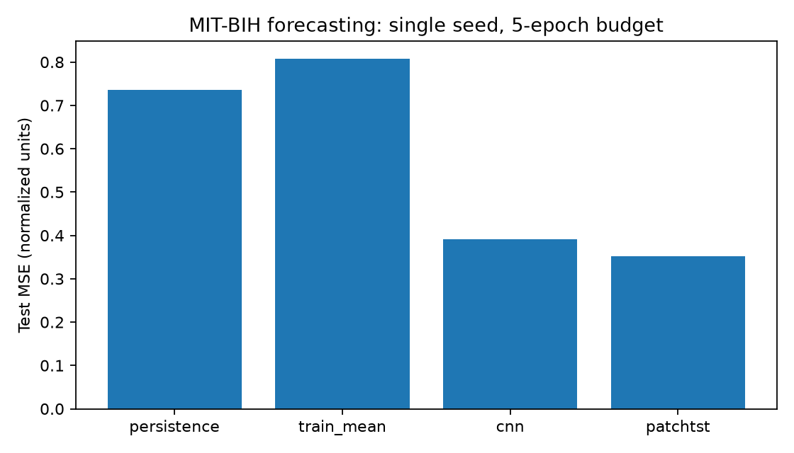
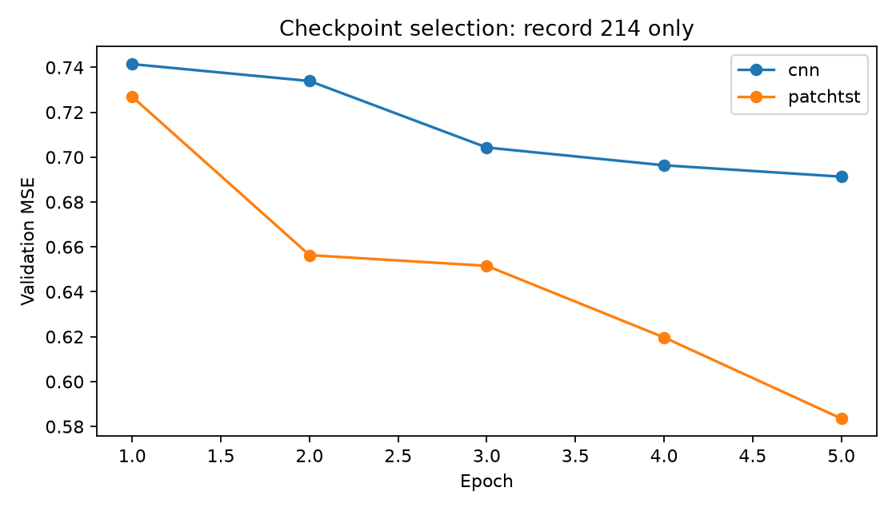
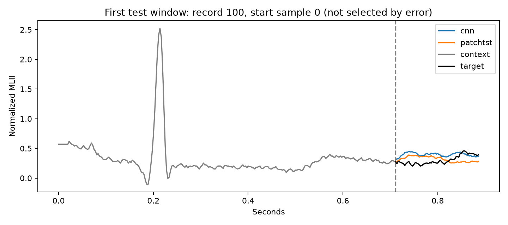
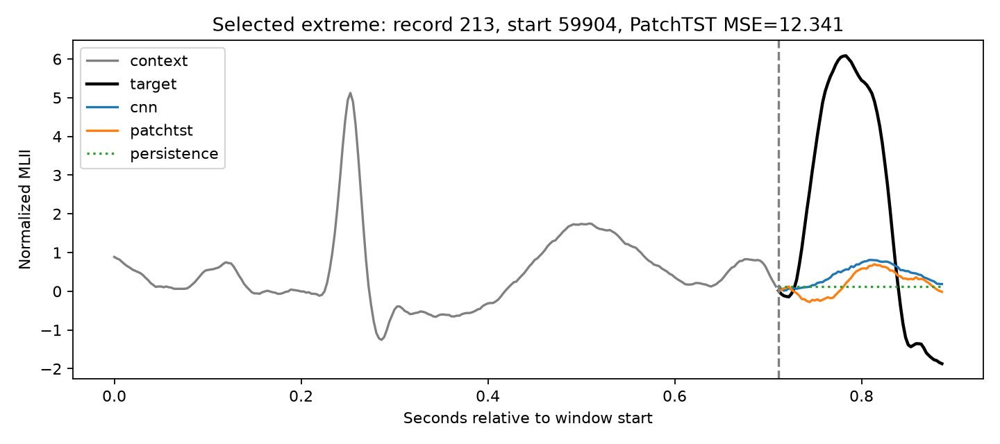

# MIT-BIH 首次真实数据实验

日期：2026-10-15。单次 seed=42 探索性实验，不是论文原始指标复现或基础模型评估。

## 固定实验协议

- 数据：MIT-BIH Arrhythmia Database 1.0.0；360 Hz，按名字选择 MLII。
- 20 条训练记录、1 条验证记录（214）、22 条测试记录；排除与 202 同人的 201，另排除起搏记录。
- 各记录完整读取后构窗；context=256（0.711 秒），horizon=64（0.178 秒），stride=512，无 --limit。
- 步长意味着离散采样预测窗口，不是对连续波形全部采样点进行预测。目标区间互不重叠。
- 仅训练集拟合全局均值/标准差；无滤波、无重采样、无注释标签。
- CNN、PatchTST-style 均训练 5 轮；AdamW lr=0.001，weight_decay=0.0001，clip_norm=1，batch=64。
- 用验证 MSE 选 checkpoint；完成训练后才评估测试集。未用测试集调参。
- CPU，2 个 PyTorch 线程；完整软件版本见 environment.txt。
- 实际窗口数：{'train': 25380, 'val': 1269, 'test': 27918}。

## 实测结果

| 模型 | 最佳轮次 | Val MSE | Test MSE | Test MAE | 记录宏平均 MSE | 秒数 |
|---|---:|---:|---:|---:|---:|---:|
| persistence | N/A | 1.275712 | 0.735008 | 0.422209 | 0.735008 | 1.0 |
| train_mean | N/A | 1.133894 | 0.807830 | 0.651700 | 0.807830 | 1.0 |
| cnn | 5 | 0.691303 | 0.391751 | 0.356620 | 0.391751 | 39.8 |
| patchtst | 5 | 0.583540 | 0.351394 | 0.319932 | 0.351394 | 70.3 |

MSE/MAE 单位基于训练集标准差归一化；MSE 乘 std²、MAE 乘 std 可转换回原信号单位。训练均值基线始终输出归一化后的 0。





极端案例选择：记录 213，起点 sample=59904（记录内 166.400 秒），窗口 PatchTST-style MSE=12.340559。先选该模型记录均误差最高的测试记录，再选其中窗口误差最高者；非典型样本，未用于调参。



## 逐记录结果与失败案例

以下按 PatchTST-style 测试 MSE 从大到小展示全部测试记录；属于事后误差分析，未据此重新训练。

| 测试记录 | Persistence MSE | Mean MSE | CNN MSE | PatchTST-style MSE |
|---|---:|---:|---:|---:|
| 213 | 3.194536 | 1.934946 | 1.357379 | 1.263255 |
| 233 | 1.936174 | 1.461843 | 0.963845 | 0.782667 |
| 219 | 1.313846 | 1.273803 | 0.725828 | 0.679814 |
| 113 | 0.927719 | 0.992445 | 0.562586 | 0.509392 |
| 200 | 0.953090 | 0.984205 | 0.514796 | 0.461125 |
| 105 | 0.845519 | 0.809184 | 0.539858 | 0.458315 |
| 230 | 0.689732 | 0.764285 | 0.429542 | 0.374771 |
| 212 | 0.682155 | 0.754447 | 0.366030 | 0.333412 |
| 202 | 0.576360 | 0.678026 | 0.326454 | 0.320673 |
| 221 | 0.574697 | 0.657136 | 0.310036 | 0.292199 |
| 103 | 0.677977 | 0.545747 | 0.331228 | 0.286541 |
| 234 | 0.616439 | 0.739255 | 0.299776 | 0.286361 |
| 228 | 0.479242 | 0.783035 | 0.297286 | 0.282484 |
| 123 | 0.559715 | 0.830399 | 0.291826 | 0.264680 |
| 231 | 0.468818 | 0.564531 | 0.272878 | 0.208698 |
| 210 | 0.443898 | 0.547222 | 0.186436 | 0.176483 |
| 111 | 0.269649 | 0.557435 | 0.179624 | 0.173257 |
| 117 | 0.226411 | 0.920440 | 0.182017 | 0.149743 |
| 121 | 0.188074 | 0.914895 | 0.135647 | 0.139797 |
| 100 | 0.267090 | 0.209452 | 0.150883 | 0.130840 |
| 222 | 0.132413 | 0.431816 | 0.103073 | 0.092822 |
| 232 | 0.146614 | 0.417714 | 0.091502 | 0.063350 |

## 本次观察

- PatchTST-style 测试 MSE 比 persistence 低 52.19%，比 CNN 低 10.30%。
- PatchTST-style 在 21/22 条测试记录上 MSE 低于 CNN；未优于 CNN 的记录为 ['121']。这不是多种子显著性检验。
- 按 PatchTST-style 记录均误差选择的困难记录为 213。所示极端窗口中，两种训练模型均明显低估目标高幅波形；总体误差改善不代表峰值预测已解决。
- CNN 与 PatchTST-style 的最佳验证 checkpoint 都是第 5 轮，尚不能判断模型已收敛。
- 后续可以预先定义峰值区域评价、延长训练预算和多种子协议；本次没有根据测试结果更改模型或重新训练。

## 解释范围

- 本次只有一个随机种子、一个窗口配置、5 轮训练；不能据此判断模型家族的普遍优劣。
- 验证集仅一条记录，选模可能不稳定，未来应采用多受试者验证或交叉验证。
- PatchTST 为本仓库单变量结构改编，无预训练、无官方完整配方；尚未评估 Chronos/TimesFM。
- 任务是短窗口波形预测，不支持长程依赖、少样本、异常检测、诊断能力或临床效用结论。
- 跨受试者测试仅说明此固定切分上的结果，不等于跨数据集泛化。
- 峰值附近误差及原始记录质量需要进一步分析，不把高误差直接解释为心律失常。

## 复跑

```bash
python -m pip install -r requirements.txt
bash scripts/run_mitbih.sh
python -m pip install matplotlib
python scripts/summarize_mitbih.py
```

原始数据与 checkpoint 不上传。每个模型 JSON 保留完整配置、训练历史、数据 manifest/校验摘要、代码版本与逐记录指标。
初始代码与本次云端运行由 AI 助手执行；使用者应独立复跑、理解并分析结果后再作为自己的能力证明。
